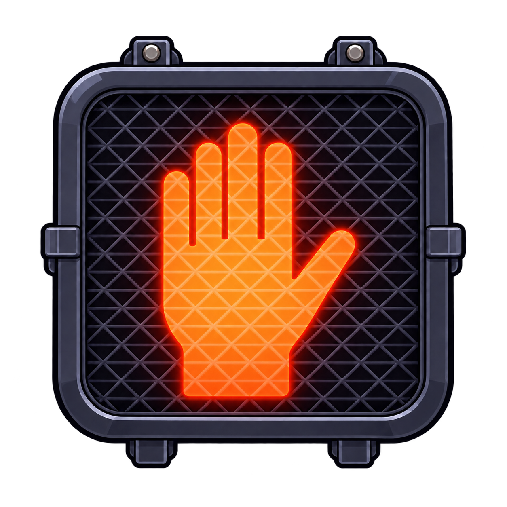

# 🚶 Pedestrian Safety Crosswalk Game 🚦

An interactive, educational web game designed to teach children and young explorers essential pedestrian safety rules, crosswalk signals, and street hazard awareness.



---

## 🎮 Game Features

* **Authentic Pedestrian Signals**:
  * 🛑 **Solid Stop Hand**: Wait safely on the curb behind the tactile pavers until the light changes.
  * ⚠️ **Flashing Blinking Light**: Amber flashing signal means don't start crossing!
  * 🟢 **Walk Signal**: Safely cross the white zebra stripes when traffic halts.
  * 🛎️ **Interactive Crosswalk Button**: Walk up to the signal pole and press **SPACEBAR** (or tap) to request the crosswalk!

* **Dynamic Street Scenarios**:
  * 👥 **Group Crossings**: Wait on the curb with other pedestrians and cross together—don't sprint ahead!
  * 🚸 **School Crossing Guard**: Wait for the guard to blow their whistle, halt oncoming traffic with their stop paddle, and signal you forward.
  * 🐕 **Friendly & Nervous Dogs**: Approach dog owners on the sidewalk and press **SPACEBAR** to ask permission to pet. If an owner gives a thumbs down, respect their space and walk away!
  * 🌉 **Pedestrian Footbridge (Overpass)**: Choose between an unsafe crossing without a crosswalk or taking the elevated footbridge across high-speed roads.
  * 🚐 **Stranger Danger Awareness**: Avoid parked vans and strangers calling out from the curb—steer around them safely on the sidewalk!
  * ⚡ **Secret Cybertruck Reward**: Complete a flawless run across all intersections without falling down to watch the Cybertruck cruise by!

---

## 🕹️ Controls

| Action | Controls |
| :--- | :--- |
| **Move Explorer** | **W / A / S / D** or **Arrow Keys** |
| **Mouse / Touch** | **Click & Hold / Drag** anywhere on screen |
| **Interact (Button / Dogs)** | **SPACEBAR** or tap on character/sign |
| **Audio** | Sound toggle button in the top menu |

---

## 🚀 Running Locally

```bash
# Clone the repository
git clone https://github.com/metsfanguy/pedestrian-safety-game.git

# Navigate into project folder
cd pedestrian-safety-game

# Start local server
node server.js
```

Open your browser and visit: `http://localhost:3000`

---

## 📦 Tech Stack

* Pure **Vanilla JavaScript** (HTML5 Canvas 2D)
* Custom Web Audio API synthesizer for retro sound effects
* Zero external framework dependencies — lightweight, fast, and responsive on both desktop and mobile!
